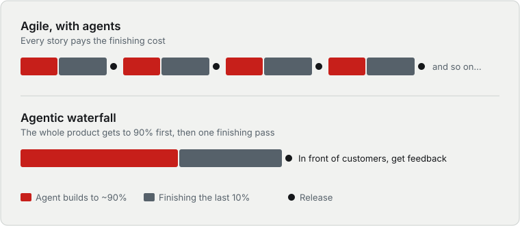

I've been building software a little differently lately. Big plan up front, build the whole thing, finish it, then ship it. If that sounds a lot like waterfall, that's because it is. I've started calling it agentic waterfall, and I think it's actually a better way to work than the agile process most of us grew up with, at least now that agents are writing most of the code.

I know. Waterfall. Hear me out.

### Why We Stopped Doing Waterfall

Software used to be built with the waterfall method. You'd gather all the requirements, design the whole system, build all of it, test it, and finally release it. The problem was how long that took. By the time you shipped, the market had moved on, and you'd built a very polished version of something nobody wanted anymore.

So we switched to agile. Instead of one giant release, you build in small slices, get each one in front of customers, and let their feedback steer what comes next. You can't fall too far behind the market if you're shipping small pieces all the time.

That made a lot of sense when humans were writing all of the code.

### The Last 10%

Here's what I keep running into with agentic coding: on most stories, the agent gets you about 90% of the way there really quickly. Then there's the last 10%. The finessing. The part where you poke at it, notice the things that are a little off, and clean it up until it's actually ready for a customer to see and use.

That's a problem for agile. If you're working iteratively, every small story goes through the same cycle: the agent gets it to 90% fast, and then you stop and finesse the last 10% before it can ship. Then you do it again for the next story. And the next one. You end up paying the finishing cost over and over, and it really slows you down.

### Agentic Waterfall

So flip it around. Let the agent get the *entire product* to 90% very quickly. Then do one finishing pass over the whole thing, and get it out in front of customers.

You still spend time finessing, but you're doing it once instead of once per story. And building the whole thing is fast enough now that you don't have the old waterfall problem of the market moving on while you're still building.

It's important to note that this is still iterative, and in a lot of ways it's still agile. The point is still to get something in front of customers quickly and let their feedback guide you. The difference is just the size of the chunk you build before you stop to polish. With agents, I think the bigger chunk wins.

### My Workflow

Here's what this looks like for me in practice:

1. **Plan heavily.** I start with a really heavy brainstorming and planning session with Claude, and I write the result out to Notion.
2. **Break it down.** In a separate Claude session, I have it break the plan down into issues in Linear, and then group those issues into milestones.
3. **Make every milestone a release.** Each milestone is a release target: something that would meaningfully change the user's experience and give them new functionality.
4. **Knock them out.** Then I just start knocking out the milestones one by one, each in its own Claude session, releasing as quickly as possible.

That's it! All of the planning happens up front, which is the waterfall part. Releasing each milestone as soon as it's ready is what keeps it agile.

### Wenchang

My public example of this is [Wenchang](https://github.com/msiebert/wenchang), a Python library that gives AI agents persistent memory: a filesystem of markdown files that the agent reads and writes through tools.

If you poke around the repo, you can see the shape of the workflow. The instructions the agents follow in that repo say to work one Linear issue at a time. The first tagged release didn't come out as a tiny slice, either. It shipped with the storage layer, the seven memory tools, scope-based authorization, the prompt layer, an MCP adapter, and a [documentation site](https://msiebert.github.io/wenchang/), all in one go. Then the next release was a round of smaller fixes and tweaks.

I've been working this way at work too, on projects I can't share here (sorry). Same process: plan it all up front, break it into milestones, and knock them out.

---

### Waterfall, But Fast

The reason we left waterfall was speed. Agents fixed the speed. So I think it's worth taking another look at the old way, especially if you keep finding yourself stuck polishing the last 10% of one small story after another.

Let me know if you've been working this way too, or if you think I'm crazy for saying nice things about waterfall. I'd love to hear how other people are structuring their work around agents.
