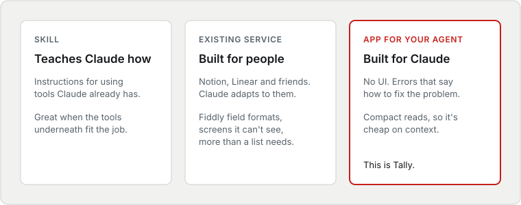

I wanted to get back into keeping a todo list. When I looked at the tools I already had, they all felt too heavy. Notion and Linear are great for real projects, but way too much for "buy milk." And my grocery list lived in a separate app on my phone that I updated by hand.

Lately Claude has become my interface into all sorts of software. Instead of opening an app and clicking around myself, I just ask Claude. So what I wanted was dead simple: a list my agent could manage for me, so keeping it up wouldn't take any work. Nothing that existed was quite that, so I built one. It's called [Tally](https://msiebert.github.io/Tally/), and it's a todo app with no UI, because I'm not the one using it.

### Skills vs. Apps

The usual way to give Claude a new ability is a skill: instructions that teach it how to do something with tools it already has. But a skill can only work with what's already there. When the thing underneath is built for people, the skill turns into a list of workarounds. Sometimes your agent doesn't need better instructions. It needs a better tool.

So that's Tally: an MCP server, running locally on my Mac, whose only user is Claude.

### Designing for an Agent

Once you decide the agent is the user, a lot of design decisions get easier, and some of them come out a little weird.

**There's no UI.** The [agent guide](https://msiebert.github.io/Tally/llms.txt) literally says "There is no UI; you are the user interface." If I want to know what's on my list, I ask Claude.

**Errors are written for the agent.** The most useful thing an error can do for an agent is tell it exactly how to fix the problem, so it can just try again:


Unknown tags 'bugg', 'urgnt'. Tags must be created before use: call create_tag first, or fix the spelling. Existing tags: 'bug', 'idea'.


Having to create tags first would annoy a human. For an agent, it means a typo can't quietly split one tag into two.

**Lists carry instructions.** Each list can hold instructions like "item titles must start with a verb," so Claude picks up my preferences without me repeating them.

**Context is the scarce resource.** Reads are paginated and compact, and list instructions only come back on the first page. A human doesn't care if a screen repeats itself. An agent pays for it in tokens.

**Order is priority.** There are no priority fields. The first item is the most important one, and Claude moves things up and down to change that.

### Building It (While Watching a Movie)

The idea had been bouncing around in my head for a couple of days, so by the time I sat down on Saturday, I already knew what it should be.

I followed the same process I wrote about in [Agentic Waterfall](/agentic-waterfall/). I brainstormed a design doc with Claude in Notion, Claude broke it into 11 tickets in Linear, and I had Claude Code work through them while I watched a movie. All 11 commits landed in about 20 minutes. It was small enough that I skipped milestones and built it all at once to about 90%.

### Testing It on the Agent

If your user is an agent, your usability tests should be on the agent too. Tally has a test script that hands a real Claude Code session a small workflow, then asks for a summary "and anything about the tools that confused you."

Claude got everything right, and flagged three things. Two were real: reordering within a list used a different tool than moving between lists, and that tool called its position argument `to` instead of `position`. I fixed both. The third, completing an item that's still blocked, is on purpose.

That's the last 10% from agentic waterfall, except the user told me where the rough edges were.

### Running It

If you want to try it, you'll need Rust:


cargo install --git https://github.com/msiebert/Tally
claude mcp add tally --scope user -- tally


Or just point your agent at the [Tally site](https://msiebert.github.io/Tally/). There's an `llms.txt` there written so an agent can figure out Tally on its own.

---

### Your Agent Needs Software Too

People have been talking for a while about how AI makes custom software cheap enough to build just for yourself. I think the more interesting version is building software for your agent. When a skill can't get Claude where you want it, because the tools underneath were made for people, you can just make it a better tool. It took me an afternoon and a movie.

I'd love to hear what you'd build for your own agent, or if you've already built something like this. Let me know!
